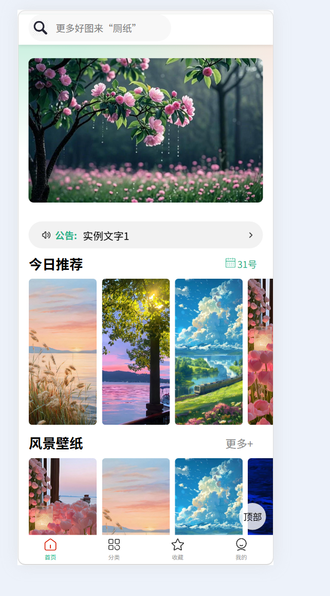
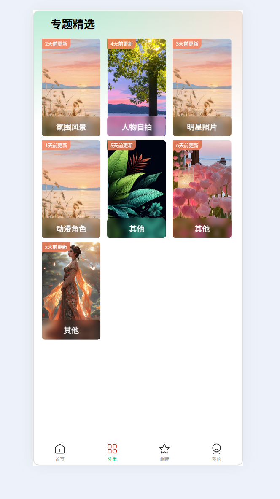
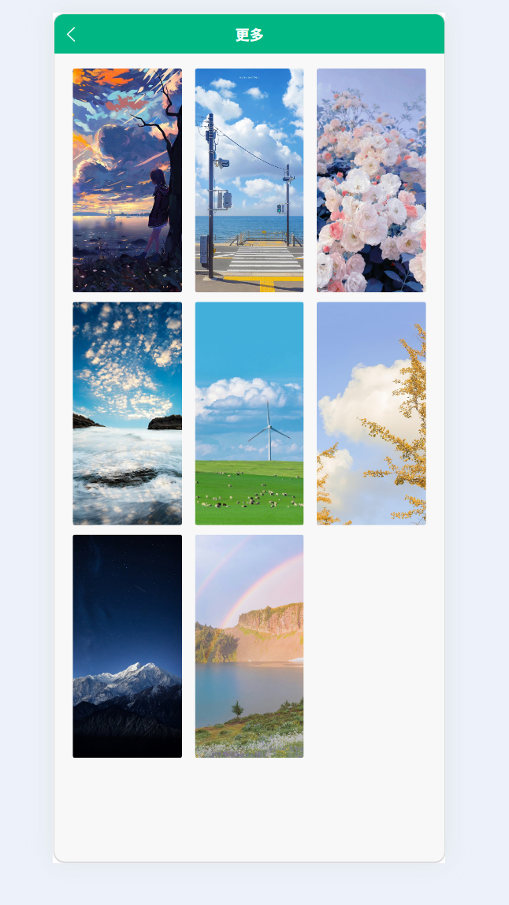
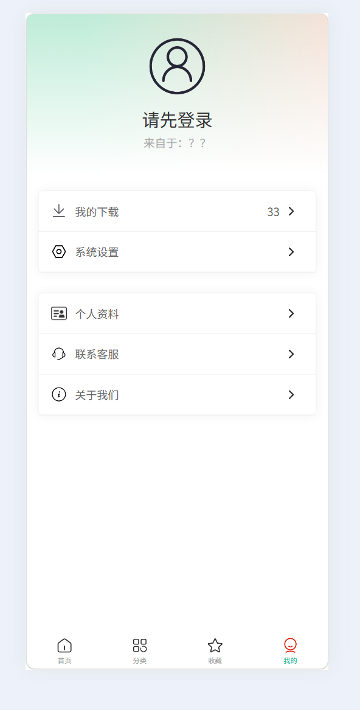

# 壁纸百宝箱 · wallpaper-miniapp

一个基于 **uni-app + uniCloud** 的壁纸类小程序 / H5 双端应用。首页内容（轮播、公告、推荐壁纸）全部由云数据库驱动，支持多图横向滑动、大图预览、下拉刷新与回到顶部。

> 这个项目是我独立完成的：需求设计、页面开发、云数据库与云函数、以及多端适配。
> 选它作为个人项目，是因为它同时覆盖了**移动端布局、组件封装、云端数据接入**三块内容，而不只是一个静态页面。

---

## 目录

- [效果预览](#效果预览)
- [功能清单](#功能清单)
- [技术栈](#技术栈)
- [项目结构](#项目结构)
- [快速开始](#快速开始)
- [云数据库设计](#云数据库设计)
- [云函数](#云函数)
- [关键实现](#关键实现)
- [已知问题与改进路线](#已知问题与改进路线)
- [更新记录](#更新记录)
- [关于作者](#关于作者)

---

## 效果预览

<!--
  截图就绪后，删除下面这对注释符号，并保证 docs/preview/ 下有对应图片。
  建议尺寸 750×1334（或真机截图），文件名固定为四张。
-->

| 首页 | 分类 | 分类预览 | 我的 |
| :---: | :---: | :---: | :---: |
|  |  |  |  |

---

## 功能清单

### 首页

| 功能 | 说明 | 状态 |
| --- | --- | :---: |
| 自定义导航栏 | 沉浸式状态栏，标题与搜索框合并在一行 | ✅ |
| 轮播图 | `swiper` + 自定义指示点，手势切换 | ✅ |
| 公告条 | 纵向滚动 `swiper`，点击弹层展示详情 | ✅ |
| 壁纸模块 ×3 | 今日推荐 / 风景 / 人物，横向滚动列表 | ✅ |
| 大图预览 | `uni.previewImage`，多图左右切换、双指缩放 | ✅ |
| 下拉刷新 | `onPullDownRefresh` + `uni.stopPullDownRefresh` | ✅ |
| 回到顶部 | 固定定位按钮，滚动超过阈值后出现 | ✅ |
| 云端数据接入 | 4 个数据集合并发拉取，按 `type` 分组渲染 | ✅ |
| 搜索框 | 仅完成 UI，未接搜索逻辑 | 🚧 |

### 分类 / 详情

| 功能 | 说明 | 状态 |
| --- | --- | :---: |
| 分类页 | 专题精选 × 分类主题，复用壁纸盒子组件 | ✅ |
| 分类详情列表 | `classifylist` 页，接收主题参数渲染全部图片 | ✅ |

### 我的 / 登录

| 功能 | 说明 | 状态 |
| --- | --- | :---: |
| 我的页 | 头像、昵称、功能入口列表 | ✅ |
| 登录页 | 账号密码表单、非空校验、毛玻璃视觉 | 🚧 表单校验完成，未接鉴权接口 |
| 收藏页 | 空状态占位 | 🚧 数据层未接入 |
| 我的下载 / 系统设置 / 个人资料 / 联系客服 / 关于我们 | 5 个入口页 | 🚧 占位页 |

> 「🚧」= 有意留待后续迭代，不是遗漏。当前版本聚焦**首页浏览链路**的完整可用。

---

## 技术栈

| 分类 | 选型 | 用途 |
| --- | --- | --- |
| 框架 | uni-app（Vue 3） | 一套代码编译到微信小程序 + H5 |
| 视图 | Vue 2/3 语法兼容 | `#ifdef VUE3` 条件下双版本入口 |
| 样式 | SCSS | 变量、嵌套、`rpx` 响应式单位 |
| 云服务 | uniCloud（阿里云版） | 云数据库 + 云函数 + CDN 存储 |
| 图标 | 本地 `static/icon/` | 21 个 tabBar 与功能图标 |
| 工具 | HBuilderX、微信开发者工具、Git | 开发、调试、版本管理 |

**为什么用 uniCloud 而不是自己搭后端：** 这个项目的数据结构简单（4 张表、读多写少），独立部署一套 Node 服务会带来额外的服务器成本和发布流程。uniCloud 直接给到数据库 + 云函数 + CDN.

---

## 项目结构

```text
wallpaper-miniapp/
├── components/                        # 全局业务组件
│   ├── navbar/navbar.vue              #   自定义导航栏（透明背景 + 搜索框）
│   ├── banner/banner.vue              #   轮播图
│   ├── announcement/announcement.vue  #   公告条 + 详情弹层
│   ├── Lists/Lists.vue                #   横向滚动列表容器
│   ├── WallpaperBox/WallpaperBox.vue  #   壁纸盒子（具名插槽，标题可配置）
│   ├── ThemeItem/ThemeItem.vue        #   分类主题项，点击进入详情
│   └── BackToTop/BackToTop.vue        #   回到顶部（安全区降级）
│
├── pages/
│   ├── tabbar/
│   │   ├── index/index.vue            # 首页：取数、分组、驱动全部模块
│   │   ├── classify/classify.vue      # 分类：专题精选 + 主题列表
│   │   ├── collection/collection.vue  # 收藏：空状态占位
│   │   └── mine/mine.vue              # 我的：个人信息 + 功能入口
│   ├── classifylist/classifylist.vue  # 分类详情列表
│   ├── login/login.vue                # 登录页
│   └── MineList/                      # 我的下载 / 系统设置 / 个人资料 / 联系客服 / 关于我们
│
├── uniCloud-aliyun/
│   ├── cloudfunctions/                # 4 个云函数（批量写入 / 删除）
│   └── database/                      # 4 张表的 schema + JQL 查询示例
│
├── static/icon/                       # 21 个本地图标
├── uni_modules/                       # 内置模块（uni-id-common 等）
├── uni-modules/uni-nav-bar/           # 参考用的第三方导航栏组件源码
├── src/router/index.js                # 学习记录：vue-router 配置示例（未接入项目）
├── AllCSSCommand.md                   # 学习笔记：CSS 常用命令速查
│
├── App.vue                            # 全局样式 + globalData
├── main.js                            # 入口（Vue2 / Vue3 双分支）
├── pages.json                         # 页面注册 + tabBar + 全局样式
├── manifest.json                      # 应用配置（appid、H5 路由模式等）
└── uni.scss                           # 全局 SCSS 变量
```

**关于 `src/`、`AllCSSCommand.md`、`uni-modules/`：** 这三处是学习记录与参考代码，保留在仓库里方便回查，**不参与项目构建**（`pages.json` 未引用，主入口未 import）。

---

## 快速开始

### 环境要求

| 工具 | 版本 | 说明 |
| --- | --- | --- |
| HBuilderX | 3.8+ | 推荐，云函数上传需依赖它 |
| 微信开发者工具 | 最新稳定版 | 预览小程序端 |
| Node.js | 16+ | 仅安装依赖时需要 |

### 运行

```bash
git clone https://github.com/zhaowendao-cell/wallpaper-miniapp.git
```

1. **用 HBuilderX 打开项目目录**（`文件 → 打开目录`）
2. **绑定云服务空间**：右键 `uniCloud-aliyun` → `关联云服务空间`
   > 需替换为你自己的 uniCloud 空间，否则云端数据读不到
3. **上传云函数**：右键 `uniCloud-aliyun/cloudfunctions` → `上传所有云函数`
4. **初始化数据库**：在 uniCloud 控制台创建 4 个集合（见下方表结构），导入初始数据
5. **运行**：
   - 小程序端：`运行 → 运行到小程序模拟器 → 微信开发者工具`
   - H5 端：`运行 → 运行到浏览器`

### 替换为你自己的配置

| 位置 | 需要改什么 |
| --- | --- |
| `manifest.json` → `mp-weixin.appid` | 换成你自己的小程序 AppID |
| `uniCloud-aliyun/` | 换成你自己的云服务空间 |
| `pages/tabbar/index/index.vue` → `getImgUrl()` | 换成你自己的 CDN 域名 |
| `manifest.json` → `h5.router.base` | 部署到子路径时按需调整 |

---

## 云数据库设计

首页需要的全部内容都从云端读取，4 张表按**内容类型**拆分，最终在前端合并。

### 表结构

| 集合 | 作用 | 主要字段 |
| --- | --- | --- |
| `AllData` | 首页主数据（轮播、公告、三个壁纸模块） | `type`、`imgurl`、`title`、`name` |
| `wallpaperC` | 分类页图片 | `type`、`imgurl`、`name` |
| `ShowThePic` | 专题精选图片 | `type`、`imgurl`、`name` |
| `ThemeItemListImgArr` | 分类详情（某个主题下的全部图片） | `type`、`imgurl`、`name` |

### `type` 字段的分组映射

`type` 是前端渲染的唯一依据，映射关系写在 `pages/tabbar/index/index.vue` 的 `groupMap` 里：

| `type` 值 | 渲染为 | 页面位置 |
| --- | --- | --- |
| `banner` | 轮播图 | 顶部 `banner` 组件 |
| `announcement` | 公告条 | 轮播下方 `announcement` 组件 |
| `recommendation` | 今日推荐壁纸盒子 | 第一个 `WallpaperBox` |
| `scenery` | 风景壁纸盒子 | 第二个 `WallpaperBox` |
| `character` | 人物壁纸盒子 | 第三个 `WallpaperBox` |
| `ShowThePic` | 专题精选 | 分类页首个 `WallpaperBox` |
| `Themeltem` | 分类详情 | 分类页 `ThemeItem` 列表 |

> **注意：** `Themeltem` 里的字母是 `l`（小写 L），不是 `I`。这是历史命名，改动需同步更新数据库、云函数和 `groupMap` 三处。

---

## 云函数

| 云函数 | 作用 | 入参 |
| --- | --- | --- |
| `AllDataBatchInsert` | 批量写入首页主数据 | `{ action, list }` |
| `WallPaperCBatchInsert` | 批量写入分类图片 | `{ action, list }` |
| `ShowThePicBatchlnsert` | 批量写入专题精选图片 | `{ action, list }` |
| `ThemeItemListImgArr` | 分类详情图片的批量写入 / 删除 | `{ action: 'batchAdd' \| 'batchDelete', list }` |

统一协议：

```js
await uniCloud.callFunction({
  name: 'ThemeItemListImgArr',
  data: {
    action: 'batchAdd',   // batchAdd | batchDelete
    list: [ /* 数据数组 */ ]
  }
})
```

设计成「批量」而不是「单条」的原因：这些数据是**运营侧一次性录入**的图文素材，一次几十到上百条，逐条调用会产生大量冷启动与网络往返。

> `ShowThePicBatchlnsert` 中的 `lnsert` 是拼写错误（应为 `Insert`）。保留原样是为了与云端已部署的函数名保持一致，改名需同步更新调用方。

---

## 关键实现

### 1. 四张表并发拉取 + 按 type 分组

首页要展示 7 种内容，来自 4 张表。串行请求会产生 4 次等待，这里用 `Promise.all` 并发，拿到结果后**合并成一个数组**再分组：

```js
const db = uniCloud.database()
const p1 = db.collection("AllData").get()
const p2 = db.collection("wallpaperC").get()
const p3 = db.collection("ShowThePic").get()
const p4 = db.collection("ThemeItemListImgArr").get()

Promise.all([p1, p2, p3, p4]).then(([res1, res2, res3, res4]) => {
  const allData = [
    ...res1.result.data, ...res2.result.data,
    ...res3.result.data, ...res4.result.data
  ]

  // 清空所有目标数组，避免下拉刷新时数据堆叠
  Object.values(groupMap).forEach(varName => { this[varName] = [] })

  allData.forEach(item => {
    const varName = groupMap[item.type]
    if (varName) {
      item.imgurl = this.getImgUrl(item.imgurl)
      this[varName].push(item)
    }
  })
})
```

**两个细节：**
- 分组前先清空目标数组，否则下拉刷新会导致列表越刷越长
- `if (varName)` 兜底：数据库里新增未知 `type` 时跳过，而不是抛错白屏

### 2. 具名插槽让组件可配置

壁纸盒子要在多个位置复用，标题和右侧操作区各不相同。用**具名插槽**把控制权交给父页面：

```vue
<!-- WallpaperBox.vue -->
<scroll-view scroll-x class="box">
  <view class="box-head">
    <view class="box-title"><slot name="name">默认标题</slot></view>
    <view class="box-more"><slot name="custom">更多</slot></view>
  </view>
  <view class="box-list"><!-- 图片列表 --></view>
</scroll-view>
```

```vue
<!-- 父页面调用 -->
<WallpaperBox>
  <template #name>专题精选</template>
</WallpaperBox>
```

### 3. 底部安全区三级降级

小程序底部有 Home Indicator，按钮贴底会被遮挡甚至点不到。`env(safe-area-inset-bottom)` 在低版本微信基础库里不生效，所以写三级降级：

```scss
.box {
  padding-bottom: 0;
  padding-bottom: constant(safe-area-inset-bottom); /* iOS 11.0 - 11.2 */
  padding-bottom: env(safe-area-inset-bottom);      /* iOS 11.2+ */
}
```

同一个属性写三遍，不支持的后两条会被直接忽略，最终生效的是当前环境能识别的最高版本。

### 4. 云端图片的 CDN 路径拼接

数据库里只存相对路径（如 `/static/picture/a.jpg`），前端统一拼 CDN 域名。同时兼容已经存了完整 URL 的历史数据：

```js
getImgUrl(path) {
  if (!path) return ''
  if (path.startsWith('http')) return path   // 已是完整地址，直接用
  return 'https://你的CDN域名' + path
}
```

---

## 已知问题与改进路线


| # | 问题 | 现状 | 改进方案 |
| ---: | --- | --- | --- |
| 1 | 跨页数据用 `getApp().globalData` 传递 | 首页把分组结果写进 `globalData`，分类页在 `onLoad` 里读 | 迁到 **Pinia**：有响应式、有单一数据源，也避免写漏字段就静默失败 |
| 2 | 分类页存在时序竞争 | 若在首页 4 个请求返回前切到分类页，读到空数组且**不会重试** | 用 `uni.$emit` 广播「数据就绪」，或让分类页订阅 store 状态 |
| 3 | `Promise.all` 失败降级不足 | `.catch` 里只 `console.log`，用户看到空白页 | 增加骨架屏 + 错误态 + 「重试」按钮 |
| 4 | 首屏全量拉取，无分页 | 4 张表一次 `get()` 全量，数据量增长后会拖慢首屏 | 改为分页 + 骨架屏，图片懒加载 |
| 5 | 小程序模板里混用 `div / p / h2` | 部分页面沿用 H5 标签，小程序端会被降级处理 | 统一为 `view / text / image` |
| 6 | 登录仅有表单校验 | 无鉴权接口、无 token 存储、无登录态拦截 | 接入 `uni-id`（`uni_modules` 里已有依赖），补齐注册 / 登录 / 登出 |
| 7 | 收藏、下载、设置等页为占位 | 已进入页面但无数据层 | 收藏基于 `uni-id` 用户体系 + 云端收藏表 |
| 8 | 应用名不统一 | `manifest.json` 的 H5 标题为「百宝箱壁纸」，`pages.json` 为「壁纸百宝箱」 | 统一为「壁纸百宝箱」 |
| 9 | 尚未部署线上地址 | 无 GitHub Pages / 体验版二维码 | H5 构建后发布到 GitHub Pages，README 顶部挂链接 |

---

## 更新记录

**2026.10**

- 清理练习模板目录，移除 `pages.json` 未引用的死代码
- 收藏页补充空状态提示，避免点击后白屏
- 统一项目命名为 `wallpaper-miniapp`
- 补齐工程配置（`pages.json` / `main.js` / `manifest.json` / `uni.scss`）
- 新增 4 个云函数与 4 张表的 schema，数据全部迁移至云端
- 图标资源精简，移除冗余大图

**2026.09**

- 完成首页模块化改造，拆出 7 个业务组件
- 完成分类页、分类详情页
- 接入 uniCloud，替换本地 JSON 假数据

**2026.08**

- 项目初始化，搭建 tabBar 与页面骨架

---

## 关于作者

**史鹏琦** · 前端开发（Vue / 小程序）

- GitHub：[@zhaowendao-cell](https://github.com/zhaowendao-cell)
- 邮箱：315468902@qq.com
- 期望城市：宁波

目前寻找前端开发 / 初级全栈方向的机会。这个项目仍在迭代，欢迎提 Issue 指正。
